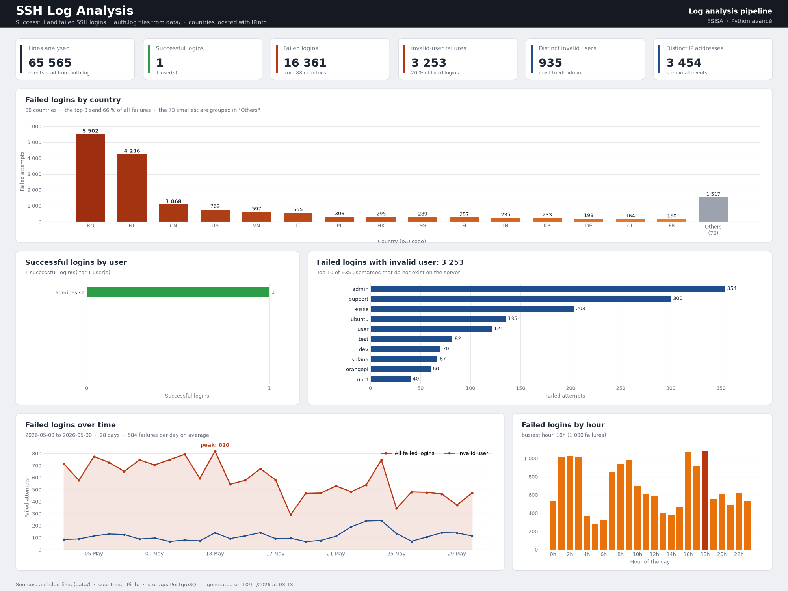

# Projet Pipeline : analyse des logs SSH

Projet du cours de Python avancé (ESISA). On l'a commencé en classe avec le professeur, puis je l'ai terminé.

## Le projet en bref

Un serveur garde dans le fichier `auth.log` toutes les tentatives de connexion SSH. Ce projet lit ces fichiers, trouve qui a réussi à se connecter, qui a échoué et d'où viennent les attaques, puis affiche tout dans un dashboard.

Tout le code est écrit en programmation procédurale : seulement des fonctions, des listes et des dictionnaires, sans aucune classe.

## Objectifs

- Lire tous les fichiers de logs du dossier `data/`, même ceux compressés en `.gz`.
- Reconnaître les connexions réussies, les échecs, et les échecs avec un utilisateur qui n'existe pas.
- Trouver le pays de chaque adresse IP qui a échoué.
- Afficher les 3 indicateurs demandés :
  - le nombre de tentatives échouées par pays ;
  - le nombre de connexions réussies par utilisateur ;
  - le nombre de tentatives échouées avec un utilisateur invalide.
- Enregistrer les erreurs de chaque module dans son propre fichier de log.

## Architecture

```
Projet-Pipeline/
├── main.py                       lance tout le pipeline dans l'ordre
├── log_config.py                 un fichier de log par module (dossier logs/)
├── settings.py                   lit les paramètres de config.json
├── config.example.json           modèle pour créer config.json
├── data/                         les fichiers auth.log (dont 2 en .gz)
├── ingestion/
│   └── read.py                   lecture des fichiers
├── processing/
│   ├── extract_transform.py      analyse des lignes avec des regex
│   └── geolocation.py            pays de chaque IP (API IPinfo)
├── storage/
│   ├── store.py                  fichiers CSV et JSON
│   ├── database.py               base PostgreSQL
│   └── geo_cache.json            pays déjà trouvés pour chaque IP
├── serving/
│   ├── statistics.py             calcul des chiffres
│   └── dashboard.py              graphiques matplotlib
├── tests/                        tests unittest
└── oop_courses/                  exemples du cours (pas utilisés par l'application)
```

## Comment marche le pipeline

1. **Lecture** : le programme lit tous les fichiers de `data/`. Les fichiers normaux sont ouverts avec `open` et les `.gz` avec `gzip.open`. Un fichier vide, absent ou abîmé est noté dans le log et ignoré, sans arrêter le programme.
2. **Extraction** : chaque ligne passe dans des expressions régulières.
   - `Accepted password for ...` : connexion réussie.
   - `Failed password for invalid user ...` : échec avec un utilisateur invalide.
   - `Failed password for ...` : échec avec un utilisateur qui existe.
   - La ligne `Invalid user ...` annonce le même essai que la ligne `Failed` qui suit, donc on ne la compte pas une deuxième fois.
   - Quand le log écrit `message repeated 4 times`, l'échec compte 4 fois.
3. **Géolocalisation** : on cherche le pays des IP qui ont échoué avec l'API IPinfo. Les adresses privées (10.x, 192.168.x, 127.x...) ne sont pas envoyées. Chaque IP n'est demandée qu'une seule fois et le résultat est gardé dans `storage/geo_cache.json`. Si l'API ne répond pas, le pays devient `Unknown` et le programme continue.
4. **Stockage** : les événements sont enregistrés dans PostgreSQL (tables `events` et `geolocation`) et aussi dans un fichier CSV. Si la base n'est pas disponible, le programme continue avec le CSV. Au lancement suivant, si les fichiers de `data/` n'ont pas changé, on relit les données déjà enregistrées au lieu de tout recalculer.
5. **Statistiques** : les chiffres sont calculés avec `collections.Counter`.
6. **Dashboard** : les graphiques sont créés avec matplotlib, enregistrés dans `serving/output/dashboard.png` puis affichés dans une fenêtre.

Les erreurs de chaque étape vont dans `logs/` : `main.log`, `ingestion.log`, `processing.log`, `geolocation.log`, `storage.log` et `serving.log`.

## Technologies utilisées

- Python 3.11 ou plus récent
- Modules standard : `os`, `gzip`, `re`, `logging`, `json`, `csv`, `datetime`, `collections`, `unittest`
- `requests` pour appeler l'API IPinfo
- `matplotlib` pour les graphiques
- `psycopg2-binary` pour se connecter à PostgreSQL
- PostgreSQL (optionnel : sans base, le programme utilise les fichiers CSV)

## Installation

```
git clone https://github.com/ilias-elg/Projet-Pipeline.git
cd Projet-Pipeline
python -m venv .venv
.venv\Scripts\activate
pip install matplotlib requests psycopg2-binary
```

Pour utiliser PostgreSQL :

1. Installer PostgreSQL et créer la base : `CREATE DATABASE log_analysis;`
2. Copier `config.example.json` en `config.json` et mettre le mot de passe de PostgreSQL et le token IPinfo.

Le fichier `config.json` contient des mots de passe, donc il n'est pas envoyé sur Git.

## Lancer le projet

```
python main.py
```

Autres options :

- `python main.py --no-show` : enregistre le dashboard sans ouvrir de fenêtre.
- `python main.py --reprocess` : refait tout le traitement même si les logs n'ont pas changé.
- `python -m unittest discover -s tests -v` : lance les tests.

## Le dashboard

En haut, des cartes donnent les chiffres principaux :

- 65 565 lignes analysées
- 1 connexion réussie
- 16 361 tentatives échouées, venant de 88 pays
- 3 253 échecs avec un utilisateur invalide, soit 20 % des échecs
- 935 noms d'utilisateurs invalides différents
- 3 454 adresses IP différentes

En dessous, on trouve les graphiques :

- **Tentatives échouées par pays** : les 15 pays qui attaquent le plus, du plus grand au plus petit, les autres regroupés dans « Others ». La Roumanie (5 502), les Pays-Bas (4 236) et la Chine (1 068) envoient à eux trois 66 % des échecs.
- **Connexions réussies par utilisateur** : une seule connexion réussie, celle de `adminesisa`.
- **Tentatives avec un utilisateur invalide** : les 10 noms les plus essayés par les attaquants. Le premier est `admin` (354 fois), suivi de `support` et `esisa`.
- **Évolution dans le temps** : le nombre d'échecs jour par jour, du 3 au 30 mai, avec environ 584 échecs par jour et un pic de 820 le 13 mai.
- **Échecs par heure** : l'heure la plus active est 18h.


